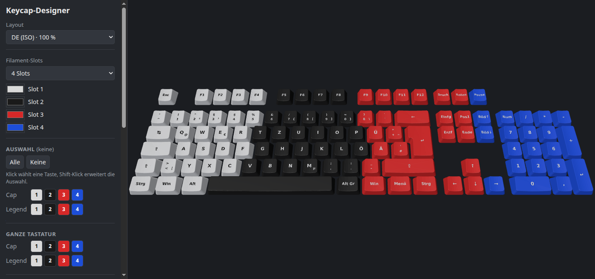

# Keycap-Designer

Browser tool to design and export 3D-printable two-colour MX keycap sets (12 layouts, Bambu Lab 3MF with multi-colour painting).

Generator und Designer für 3D-druckbare MX-Keycaps: komplette Tastaturen in **de / en / us** (QWERTZ-ISO, ISO-UK, ANSI) und **100 % / TKL / 75 % / 60 %** — zusammen 12 Layouts. Jede Taste besteht aus zwei Körpern, Cap und bündig eingelegter Legend, für den Mehrfarbdruck. Im Browser lassen sich Farben (bis 8 Filament-Slots) pro Taste vergeben, Tasten bemalen, Bilder und Muster über die Tastatur legen und alles als Bambu-3MF exportieren.



## Schnellstart

**a) Windows-Exe (ohne Installation)**
1. Unter [Releases](../../releases) die `keycap-designer.exe` herunterladen und starten.
2. Windows SmartScreen warnt bei unsignierten Programmen („Der Computer wurde durch Windows geschützt“) — „Weitere Informationen“ → „Trotzdem ausführen“.
3. Der Browser öffnet sich mit dem Designer; das Konsolenfenster schließen oder Strg+C beendet ihn.

**b) Aus dem Quellcode** (Python ≥ 3.9, keine Pakete nötig)
```bash
git clone https://github.com/Sebastianschmid1/keycap-designer.git
cd keycap-designer
python start.py            # Optionen: --port 8765  --no-browser
```
`start.py` liefert `web/` nur lokal auf `127.0.0.1` aus; der Designer läuft komplett im Browser.

## Bedienung

- **Layout** und Anzahl der **Filament-Slots** (2–8) oben wählen; die Slot-Farben sind frei einstellbar.
- **Auswählen**: Klick wählt eine Taste, Shift-Klick erweitert die Auswahl. Cap und Legend der Auswahl oder der ganzen Tastatur bekommen je einen Slot. Maus: links ziehen dreht, rechts ziehen schiebt, Rad zoomt.
- **Malen**: Slot und Pinselgröße (0,5–10 mm) wählen und auf der Tastenoberseite malen; der Radiergummi entfernt die Bemalung. Im Malmodus malt die linke Maustaste, rechts dreht, Mitte schiebt.
- **Bild**: Bild laden und auf die Auswahl spannen, auf jede ausgewählte Taste oder auf die ganze Tastatur legen; Einpassen oder Füllen, optional mit Dithering. Das Bild wird auf die gewählten Slot-Farben quantisiert.
- **Muster**: 10 Vorlagen (Klassisch, Modifier-Kontrast, Akzent, Schachbrett, Reihen, Regenbogen-Spalten, Diagonale Streifen, Wellen, Punkte, Verlauf).
- **Rückgängig** (Strg+Z), **Projekt speichern/laden** als JSON.
- **3MF exportieren**: 3MF mit allen Tasten des Layouts, Bemalung als `paint_color`.

## Druck in Bambu Studio

Die 3MF ist auf den Bambu X2D ausgelegt (Platzierung ab X ≥ 23,5 mm wegen des zweiten Extruders) und weist Teile und Bemalung den Filamenten 1…n zu. **Slot n der App = Filament n im Projekt**: In Bambu Studio die Filamente 1…n den AMS-Slots bzw. Spulen mit den passenden Farben zuordnen. Cap und Legend werden zweifarbig gedruckt; bemalte Flächen benutzen zusätzliche Filamente und verlängern Druckzeit und Wechsel.

## Entwickler

Das Frontend (`web/`) braucht keinen Build-Schritt. Die Mesh-Daten in `web/data` (werden mit committet) erzeugt der Python-Generator in `keycaps/` mit CadQuery:

```bash
python -m venv .venv && .venv/bin/pip install cadquery numpy trimesh fonttools pytest
.venv/bin/python -m keycaps.webdata       # web/data neu erzeugen (~70 s)
.venv/bin/pytest -q                       # Generator-Tests (~40 s)
node --test web/test/*.test.mjs           # Frontend-Tests (Node 22)
.venv/bin/python -m keycaps.build --all --preview --3mf   # STEP/3MF je Layout in out/
```
Aufbau und Maße: [CLAUDE.md](CLAUDE.md). Ein Tag `v*` löst den GitHub-Actions-Workflow aus, der die Windows-Exe baut und als Release anhängt.

## Lizenzen

- Projekt: [MIT](LICENSE), © 2026 Sebastianschmid1.
- three.js und fflate (in `web/vendor`, Lizenztexte `LICENSE-three`, `LICENSE-fflate`): MIT.
- Die Legend-Geometrie ist aus der Schrift **DejaVu Sans Bold** erzeugt (freie Bitstream-Vera/DejaVu-Lizenz, Nutzung und Weitergabe erlaubt).
